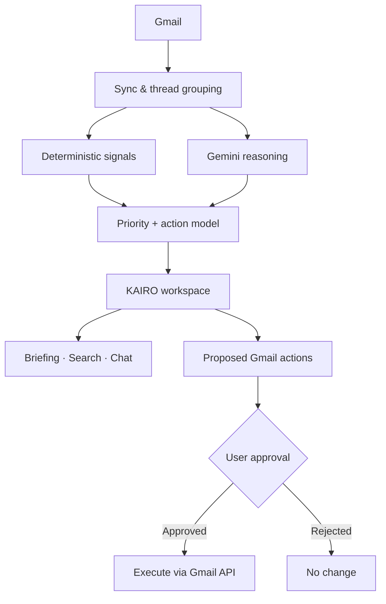

<!-- KAIRO · Paper #F5F0E8 · Ink #20222B · Vermilion #E65038 -->
<div align="center">


<strong>PERSONAL EMAIL INTELLIGENCE</strong><br/>
Turn inbox noise into a clear picture of what needs your attention.

<p>


</p>

<a href="#why-kairo">Why KAIRO</a> · <a href="#capabilities">Capabilities</a> · <a href="#architecture">Architecture</a> · <a href="#security">Security</a> · <a href="#status">Status</a>


</div>

## Why KAIRO

Email is not a task list. Yet important work gets buried between automated notifications, mailing lists, receipts, updates, and noise.

**KAIRO is an email operations agent built to surface the signal.**

It connects to Gmail, interprets messages in context, groups related activity, and helps you decide what to do next. It is designed for people whose inbox is also their work queue — especially developers working across GitHub, open source, CI systems, and professional communication.

> Less inbox maintenance. More awareness. Better follow-through.

## Capabilities

<table>
<tr>
<td width="50%" valign="top">

### Priority intelligence
- Classifies messages by urgency and relevance
- Separates critical, important, informational, and low-value mail
- Highlights messages that need a response or action
- Keeps suspicious messages distinct from ordinary noise

</td>
<td width="50%" valign="top">

### OSS intelligence
- Groups GitHub notifications by repository and pull request
- Surfaces review requests and maintainer replies
- Tracks requested changes, approvals, and merges
- Highlights CI failures and actionable discussion updates

</td>
</tr>
<tr>
<td width="50%" valign="top">

### Chat with your inbox
- Search mail using natural language
- Summarize threads and extract next actions
- Find unanswered messages and relevant context
- Draft replies for review

</td>
<td width="50%" valign="top">

### Personal operations
- Keep academic, career, personal, and financial mail visible
- Generate a focused daily briefing
- Apply structured Gmail labels
- Review proposed operations before execution

</td>
</tr>
</table>

## Priority model

| Priority | Meaning | Typical examples |
|:--|:--|:--|
| **P0** | Critical | Account security, urgent deadlines |
| **P1** | Important | Direct requests, time-sensitive work |
| **P2** | OSS intelligence | PR reviews, maintainer replies, CI |
| **P3** | General information | Updates worth retaining |
| **P4** | Low-value noise | Bulk notifications, promotions |
| **P5** | Suspicious | Potential phishing or unsafe content |

Priority is a decision aid, not a substitute for the original email. Messages remain accessible in Gmail.

## Architecture

KAIRO combines deterministic rules for predictable signals with Gemini for contextual interpretation.



- **Deterministic first:** known senders, notification patterns, deduplication, and thread grouping should not depend on an LLM.
- **Reason where needed:** Gemini handles ambiguous classification, summarization, action extraction, and drafting.
- **Ground every answer:** chat responses should be based on retrieved email data, not invented inbox facts.
- **Keep the human in control:** consequential actions are proposed and confirmed, not silently performed.

## Product surfaces

| Surface | Direction |
|:--|:--|
| Web | Primary workspace |
| Desktop | Tauri 2 client scaffolding |
| Android | Capacitor client scaffolding |
| iOS | Capacitor project scaffolding |

Native packaging and real-device verification are separate release gates; platform scaffolding does not mean installers or store-ready builds exist.

## Security

Email is untrusted input. KAIRO treats it that way.

- Gmail access uses OAuth scopes for mail modification and label management.
- Email content is data — never trusted instructions for tools or system behavior.
- Sending a message requires explicit confirmation in the product flow.
- Archive operations are distinct from deletion; KAIRO should not permanently delete mail.
- Bulk or consequential changes require approval.
- Authentication tokens and secrets must stay out of source control.
- Operational history should make changes inspectable.

**No silent sends. No permanent-delete workflow. No executing instructions found inside an email.**

## Technology

<p align="center">

</p>

| Layer | Technology |
|:--|:--|
| Interface | React 19 + TypeScript |
| Build | Vite |
| Backend | Node.js + Express |
| Email | Gmail API + OAuth |
| Reasoning | Google Gemini via `@google/genai` |
| Identity | Firebase Authentication + server-side ID-token verification |
| Desktop | Tauri 2 |
| Mobile | Capacitor 8 |

## Local development

### Requirements

- Node.js 22 or later
- npm or Bun
- A Firebase project configured for Google sign-in
- Gmail API enabled for that Google Cloud project
- Gemini API key for AI-powered features

### Setup

```bash
git clone https://github.com/aspire488/kairo-email-intelligence.git
cd kairo-email-intelligence
npm install
cp .env.example .env
```

Set the required environment values in your local `.env` file. Never commit that file.

```bash
npm run dev
```

The Vite development server is configured for port `3000`. To run the Express server:

```bash
npm start
```

Build and type-check:

```bash
npm run build
npm run lint
```

> **Configuration note:** Firebase web configuration is client-side configuration and is not equivalent to a server credential. Restrict its API key to the required APIs and authorized application origins in Google Cloud. Keep Gemini keys, OAuth client secrets, refresh tokens, and server credentials private.

## Status

<sub><strong>ACTIVE DEVELOPMENT</strong> · Not a stable public release.</sub>

| Area | Repository evidence |
|:--|:--|
| Gmail integration | Gmail API client and OAuth flow present |
| Classification | Deterministic classifier + Gemini service |
| Inbox chat | Gemini chat service and chat workspace |
| OSS intelligence | Dedicated OSS intelligence view |
| Desktop / mobile | Tauri and Capacitor project scaffolding |
| Release | Native packaging, device validation, and full security review remain release gates |

## Contributing

Issues and focused pull requests are welcome. Keep changes small, typed, testable, and explicit about what has actually been verified. Never include real inbox data, access tokens, API keys, or credentials in commits, screenshots, fixtures, or issue reports.

<div align="center">


### Your inbox has information. KAIRO finds what matters.

<sub>Built by <a href="https://github.com/aspire488">aspire488</a> · KAIRO — Know what matters.</sub>

</div>
